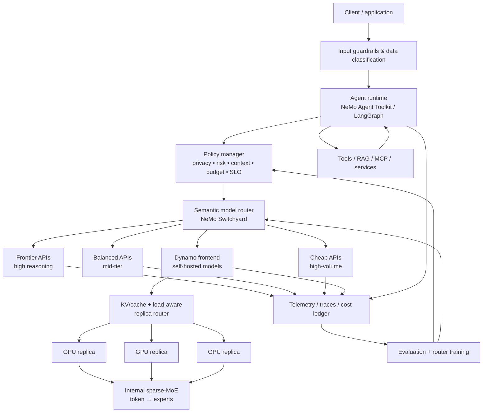
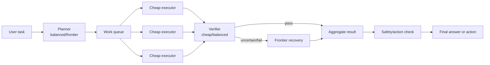
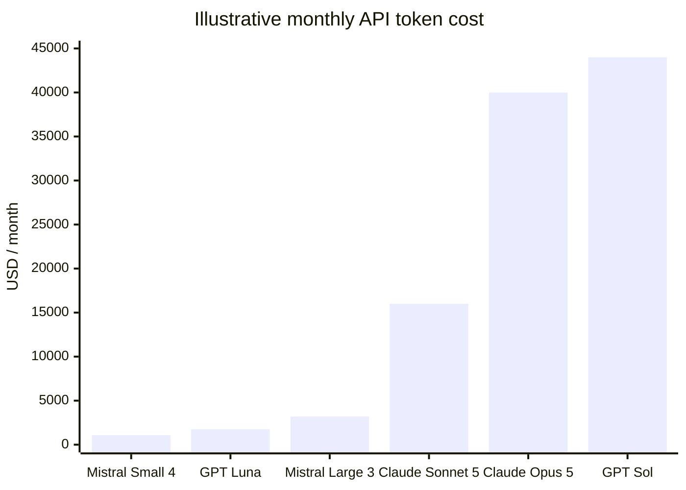
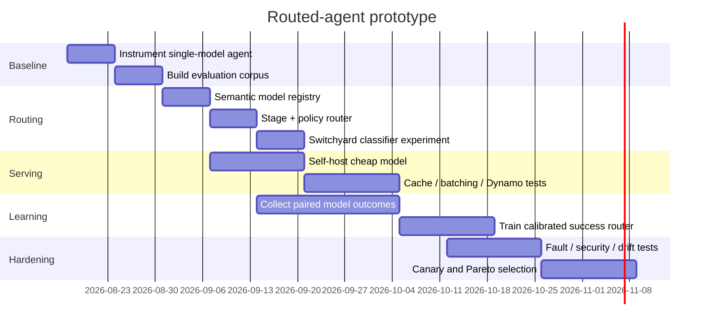
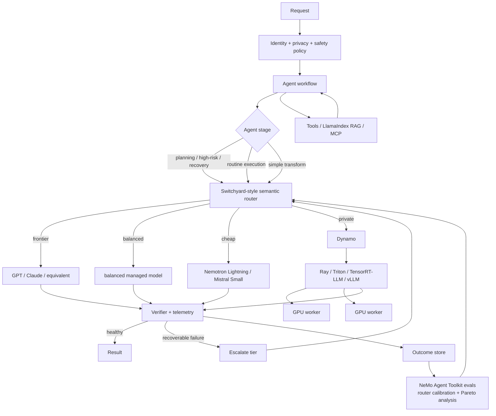

> **Reusable Core v1.10 — Source: Routed model portfolio research**
>
> NON-normative source research (ROUTING). Its adopted conclusions live in Volume II.
>
> **Precedence:** the [v1.10 kernel](../reusable-core-v1.10-kernel.md) wins any conflict with this document. Internal references to "v1.9" and to sibling documents by their former names are historical; see the [supersession map](../README.md#supersession-map).
>
> **Fidelity:** everything below the end-of-header marker is the source document reproduced byte-for-byte (`Building_a_Nemotron-Style_System_of_Routed_AI_Agents.md`, SHA-256 `aa36694c871d327d`).

<!-- v1.10 volume header end -->
# Building a Nemotron-Style System of Routed AI Agents

## Executive summary

The most important architectural conclusion is that **“following NVIDIA’s Nemotron approach” should not mean trying to recreate Nemotron training from scratch**. NVIDIA’s current stack separates several concerns that are easy to conflate:

1. **Nemotron** is primarily a model family plus an open training “cookbook”: reproducible data preparation, pretraining, supervised fine-tuning, reinforcement learning, artifact lineage, and execution recipes. NVIDIA explicitly describes the Nemotron repository as a reference implementation to fork and customize rather than an agent framework that you install. citeturn17search0turn17search7
2. **Nemotron’s internal Mixture-of-Experts architecture** performs *token-level* routing. Nemotron 3 Nano, for example, is a hybrid Mamba–Transformer sparse MoE with 31.6B total parameters and roughly 3.6B active per forward pass; its learned router activates 6 of 128 routable experts, in addition to shared experts. citeturn17search1turn17search2
3. **NeMo Switchyard** is NVIDIA’s new *system-level* model-routing layer. It routes whole LLM requests or agent stages between “weak” and “strong” models, supports classifier, stage, escalation, random and custom routing, translates OpenAI/Anthropic wire formats, and records routing decisions, latency, tokens, errors and other telemetry. NVIDIA introduced the current public Switchyard approach on August 11, 2026. citeturn16search0turn16search2turn16search3
4. **NeMo Agent Toolkit** is the agent/workflow orchestration and evaluation layer; **Dynamo, Triton, Ray Serve, TensorRT-LLM/vLLM/SGLang** belong lower in the serving stack, where they address replica selection, KV-cache locality, batching, autoscaling and GPU utilization. citeturn24search0turn24search1turn24search2turn24search3

For a new system in August 2026, I would therefore build a **three-level routing architecture**:

> **agent/stage routing → model routing → inference-instance/expert routing**

At the top, an agent policy decides *what kind of work is being done*: planning, execution, verification, retrieval, tool use, recovery, or high-risk action. In the middle, Switchyard or an equivalent custom router chooses *which model* should perform that step. At the bottom, Dynamo selects a self-hosted replica using KV-cache and load information, while a sparse model such as Nemotron independently selects internal experts for each token. This composition is much closer to NVIDIA’s emerging “system of models” philosophy than a conventional single-agent/single-LLM architecture. citeturn16search3turn16search7turn24search1

My recommended initial model pool is **not** “one cheap model plus one expensive model.” Use four semantic roles:

| Semantic role | Typical work | Suggested initial candidates |
|---|---|---|
| **Local/tiny execution** | classification, formatting, extraction, simple tool preparation | Ministral 3 3B/8B, Llama-class 8B, specialized small models |
| **Cheap general executor** | routine coding edits, RAG synthesis, tool-result interpretation, summaries | Nemotron 3.5 Lightning, Mistral Small 4, GPT-5.6 Luna |
| **Balanced reasoning** | moderate planning, verification, difficult transformations | GPT-5.6 Terra, Claude Sonnet 5, Mistral Large 3 |
| **Frontier** | ambiguous planning, hard reasoning, difficult recovery, high-risk decisions | GPT-5.6 Sol, Claude Opus 5, Nemotron Ultra-class models |

NVIDIA explicitly positions Nemotron 3.5 Lightning as a high-volume execution model and describes a complementary pattern in which frontier reasoning models handle orchestration and planning while smaller models handle the high-volume execution layer. Lightning is a 30B-total/3B-active MoE model. citeturn16search7

The legacy model names in the question—GPT-4o, Claude 3, Llama 2/3—remain useful for reproducing older experiments and compatibility testing, but I would **not hard-code those names into a greenfield 2026 architecture**. Instead, expose semantic IDs such as `frontier_reasoner`, `balanced`, `cheap_executor`, and `local_private`. Current provider offerings and prices have moved substantially beyond those examples. OpenAI currently lists GPT-5.6 Sol at $5/M input and $30/M output tokens, Terra at $2/$12, and Luna at $0.20/$1.20; Anthropic lists Claude Opus 5 at $5/$25 and Sonnet 5 at $2/$10; Mistral lists Mistral Large 3 at $0.50/$1.50 and Mistral Small 4 at $0.15/$0.60. citeturn20search0turn25view0turn20search2

The router itself should initially be **simple and heavily instrumented**. Start with hard policy constraints and stage-based routing, then add a cheap classifier, then a learned success predictor. Do **not** begin by training an elaborate neural router. RouteLLM showed that learned preference-based routers can materially reduce cost, but the 2026 LLMRouterBench re-evaluation found that many sophisticated routing methods cluster together under unified evaluation, some do not beat simple baselines, and a large part of the remaining gap to an oracle comes from failure to recall the right model. citeturn18search2turn19search0turn19search9

A useful production objective is:

\[
m^*(x)=\arg\min_{m \in \mathcal E(x)}
\left[
\lambda_q(1-\hat q_m(x))
+\lambda_c\hat C_m(x)
+\lambda_l\hat L_m(x)
+\lambda_r\hat R_m(x)
\right]
\]

where \(\mathcal E(x)\) is first restricted by **hard requirements** such as privacy, modality, context length, tool support, jurisdiction and availability; \(\hat q\) is calibrated task-success probability, \(\hat C\) is expected total call cost, \(\hat L\) is predicted latency, and \(\hat R\) is safety/operational risk. This extends the cost-quality formulations used in RouteLLM and RouterBench to the latency and system signals NVIDIA now exposes in Switchyard. citeturn18search6turn19search1turn16search3

A critical operational warning is that **Switchyard is extremely new**. Its GitHub project currently labels the software pre-alpha/experimental and warns that APIs and algorithms may change before v1.0. I would adopt its architecture and evaluate the implementation aggressively, but put it behind your own stable `ModelRouter` interface rather than make application code depend directly on every Switchyard configuration detail. citeturn16search4

The analysis below assumes no fixed regulatory regime, no fixed latency SLO, a workload dominated by text/tool-using agents, and a willingness to mix managed APIs with self-hosted open models. All cost estimates are illustrative and should be recalculated from your actual token distribution, cache rates, concurrency, model mix and provider contract.

## Nemotron and the NVIDIA system-of-models architecture

### What Nemotron itself contains

The current open Nemotron repository has a deliberately layered design. NVIDIA describes an **execution layer** under `cli/commands/` and `nemo_runspec/` and a **runtime layer** under `recipes/`. The execution layer handles configuration, experiment launching, environments, artifact resolution and job submission; runtime recipes are intentionally thin and delegate training to NVIDIA’s underlying stack. The dependency direction is from Nemotron CLI/runtime support into tools such as NeMo-Run, Megatron-Bridge and NeMo-RL rather than the reverse. citeturn17search0turn17search3

For Nemotron 3 Nano specifically, NVIDIA publishes a three-stage recipe:

```text
raw data
   ↓
pretraining     → Megatron-Bridge
   ↓
base checkpoint
   ↓
supervised FT   → Megatron-Bridge
   ↓
SFT checkpoint
   ↓
reinforcement learning → NeMo-RL / Ray
   ↓
post-trained agentic model
```

The repository provides direct scripts, cluster execution through NeMo-Run, configuration files and artifact lineage. The public recipe uses the open subset of NVIDIA’s data rather than every dataset used for NVIDIA’s reported model, so NVIDIA cautions that reproductions will not exactly match the technical-report scores. citeturn17search1turn17search7

A representative workflow from the current repository is:

```bash
git clone https://github.com/NVIDIA-NeMo/Nemotron
cd Nemotron
uv sync

# Inspect rather than immediately submit:
uv run nemotron nano3 pretrain -c tiny --run YOUR-CLUSTER --dry-run

# Launch pretraining through a configured execution profile:
uv run nemotron nano3 pretrain -c tiny --run YOUR-CLUSTER
```

Nemotron’s `env.toml` execution profiles can describe local or Slurm-style execution details and integrate experiment tracking; Ray-backed recipes are used for workloads including RL and some data preparation. citeturn17search3turn17search6

For building your **agent system**, however, the main architectural lesson to borrow is not “train a 30B model.” It is the separation of reproducible recipes, execution infrastructure, artifacts and evaluation. Unless developing a foundation model is itself the objective, training Nemotron-scale models from scratch is unnecessary for the routing problem.

### The model architecture worth borrowing

Nemotron 3 combines **Mamba-2 blocks, attention blocks and sparse MoE layers**. Nano has 32 layers, model dimension 3008, 128 routable experts, six routed experts active for a token, and two shared experts; NVIDIA reports 31.6B total parameters versus roughly 3.6B active including embeddings. It was pretrained on 25 trillion tokens and supports context lengths up to one million tokens. citeturn17search1turn17search2

The sparse-MoE idea descends directly from conditional-computation work: Shazeer et al. introduced a learned gating network that activates only a sparse subset of experts instead of running every expert on every input; Switch Transformer later simplified this to top-one expert routing and studied balancing, communication and training stability at much larger scale. citeturn18search0turn18search9

Nemotron Super/Ultra introduce NVIDIA’s **LatentMoE** variation. Rather than routing the full hidden dimension through every selected expert, the architecture projects into a smaller latent expert dimension, reducing routed memory/communication and reinvesting the savings in additional expert diversity and a larger nonlinear expert budget. NVIDIA’s controlled comparison in its Nemotron 3 white paper reports improvements over an equal-active-parameter conventional MoE across several benchmark aggregates. citeturn17search8

This distinction matters:

| Routing level | Unit being routed | Decision frequency | Primary objective |
|---|---|---:|---|
| **Sparse MoE** | token → internal experts | every token/layer | more model capacity per FLOP |
| **Agent stage routing** | workflow stage → agent/function | several times per task | specialize planning/execution/tool use |
| **Model routing** | LLM request → model tier | every model call or conversation | quality/cost/latency/risk |
| **Replica/KV routing** | model request → inference worker | every self-hosted request | cache locality/load/SLO |
| **Fallback routing** | failed request → alternative backend | exceptional path | resilience |

The first row is a learned neural-network architectural property; the other rows are distributed-system policies. Treating them as one routing problem is a design error.

### Switchyard is the closest match to what you want

NeMo Switchyard is explicitly built around the “system of models” idea. Clients address a **route ID** as though it were a normal model ID. That route can point to one target, randomly divide traffic, classify a request into weak/strong tiers, use agent-stage signals, or use an escalation policy. “Strong” and “weak” are roles assigned by the route; they are not inherent properties of particular models. citeturn16search2turn16search10

Switchyard currently supports OpenAI Chat Completions, OpenAI Responses and Anthropic Messages as client-facing protocols and can translate between provider formats through an internal neutral representation. It can therefore allow an Anthropic-speaking agent client to target an OpenAI-compatible self-hosted model, or vice versa. citeturn16search0turn16search6

A lightly adapted classifier route looks like this:

```yaml
defaults:
  api_key: ${OPENROUTER_API_KEY}
  base_url: https://openrouter.ai/api/v1
  format: openai

routes:
  smart:
    type: deterministic
    profile: coding_agent

    classifier:
      model: nvidia/nemotron-3-nano-30b-a3b
      min_confidence: 0.65
      fail_open: true
      recent_turn_window: 4

    strong:
      model: openai/gpt-4o

    weak:
      model: openai/gpt-4o-mini
```

Then:

```bash
switchyard serve --routing-profiles routes.yaml --port 4000
```

and an ordinary OpenAI client can address the logical route instead of a physical model:

```python
from openai import OpenAI

client = OpenAI(
    base_url="http://localhost:4000/v1",
    api_key="local-placeholder",
)

response = client.chat.completions.create(
    model="smart",
    messages=[
        {"role": "user", "content": "Refactor this service and preserve all tests."}
    ],
)

print(response.choices[0].message.content)
```

The concrete `gpt-4o`/`gpt-4o-mini` example mirrors NVIDIA’s current documentation and is useful as a compatibility smoke test; for a greenfield production pool, replace these with semantic/current targets after benchmarking. Switchyard’s classifier supports confidence thresholds, default-tier behavior and fail-open behavior, while its coding-agent profile can escalate requests deemed complex or reasoning-intensive. citeturn16search10

NVIDIA also supplies a **router-agent example in NeMo Agent Toolkit**, where one LLM analyzes a request and selects exactly one specialized branch. That is agent/function routing rather than model-cost routing, but the two compose cleanly: the workflow router picks *which capability* is needed, and Switchyard picks *which model* should implement it. citeturn16search9

### A useful three-router mental model

The architecture I recommend is:



The **semantic router** reasons about model capability and economics. The **Dynamo router** reasons about serving state. Dynamo’s KV router explicitly combines cache overlap with load; NVIDIA exposes a tunable weight that trades cache reuse and time-to-first-token against load spreading and inter-token latency. citeturn24search1turn24search5

That separation lets you ask the right question at each layer:

> “Should this call use Claude Opus, GPT, Nemotron or Mistral?” is not the same question as “which of six Nemotron replicas already holds this prefix in KV cache?”

## Routing algorithms and decision policy

### Sparse MoE, gating and expert routing

The generic MoE layer has experts \(E_1,\ldots,E_n\) and a learned gate \(G(x)\). A simplified gate is

\[
p = \mathrm{softmax}(W_gx)
\]

followed by sparse selection of the top \(k\) experts. Only the selected experts execute, with their outputs combined using routing weights. Shazeer et al. established this form of sparse conditional computation; Switch Transformer demonstrated that routing a token to one expert can simplify communication and improve scalability, while auxiliary balancing mechanisms help prevent a small subset of experts from absorbing most traffic. citeturn18search0turn18search9

System-level model routing is analogous conceptually but should usually **not** be differentiably coupled to the underlying frontier APIs. Instead, the router predicts attributes such as:

\[
\hat q_m(x)=P(\text{model }m\text{ succeeds}\mid x,\text{state})
\]

plus cost and latency, then applies policy.

### Static and deterministic routing

The simplest routes are often the most important baselines. A deterministic policy can map:

```text
PII / regulated data                → local_private
simple extraction / classification → tiny_local
routine agent execution            → cheap_executor
planning                            → balanced
high-risk external action          → frontier
repeated execution error           → frontier
```

This router is inexpensive, explainable and easy to audit. It should remain in your benchmark suite even after introducing learned routing, because 2026 routing benchmarks show that supposedly more sophisticated methods do not uniformly dominate simple alternatives. citeturn19search0turn26view2

Switchyard’s random router is similarly valuable as an A/B and cost-performance baseline rather than as a production intelligence mechanism. citeturn16search0

### Classifier routing

A classifier predicts difficulty or tier *before* the expensive model call. This may be:

- a tiny transformer classifier,
- a small LLM with structured output,
- an embedding + logistic/MLP model,
- a pairwise strong-vs-weak win predictor,
- a model trained from your own production traces.

RouteLLM formalizes binary routing by estimating whether a strong model is likely to outperform a weak one using preference data. Its experiments reported greater-than-2× cost savings in some settings without substantial quality degradation and showed some transfer across model pairs. Its tested router families included relatively conventional classifiers and preference-derived approaches rather than requiring another frontier model. citeturn18search2turn18search6

This is preferable to a cascade when the classifier is reliable because it avoids paying for an incorrect weak-model answer before invoking the strong model.

### Stage routing

For agents, **stage routing is frequently better than generic prompt classification** because the runtime already knows useful state:

```text
PLAN
SEARCH
EXECUTE_TOOL
READ_RESULT
WRITE_CODE
RUN_TESTS
RECOVER
VERIFY
COMMIT
```

NVIDIA’s Switchyard stage-router design is explicitly intended to exploit signals that already exist in a trajectory, including errors and tool results, rather than necessarily spending another LLM call to classify every turn. citeturn16search0turn16search3

A very strong default policy is:

| Agent stage | Default tier | Escalate when |
|---|---|---|
| Task decomposition | frontier/balanced | ambiguity, high risk |
| Retrieval-query generation | cheap | repeated retrieval miss |
| Tool-call formatting | tiny/cheap | schema uncertainty |
| Routine tool-result reading | cheap | anomaly or disagreement |
| Code edit | cheap/balanced | cross-repo design change |
| Test failure analysis | balanced | repeated or nondeterministic |
| Final verification | balanced | high-risk action |
| Recovery after loops | frontier | immediately after loop threshold |

This is the most direct practical translation of NVIDIA’s “frontier plans, efficient model executes” positioning for Nemotron 3.5 Lightning. citeturn16search7

### Escalation and cascading

A cascade runs the cheap model first and asks whether the answer is satisfactory. If not, it reruns or continues with a stronger model. FrugalGPT popularized this family of cost-aware cascades and reported dramatic savings under its historical model/pricing setup. Those exact numbers should **not** be projected onto 2026 providers, but the cascade mechanism remains important. citeturn18search3turn18search7

Switchyard now has an escalation mode that begins with the weak tier and uses a judge to detect sustained recoverable problems such as loops, errors, drift or false progress before latching the conversation onto the strong model. citeturn16search0turn16search3

The trade-off is fundamental:

\[
L_{\text{cascade failure}}
\approx
L_{\text{weak}} + L_{\text{judge}} + L_{\text{strong}}
\]

whereas pre-routing is approximately

\[
L_{\text{pre-route}}
\approx
L_{\text{router}} + L_{\text{selected model}}
\]

Cascades are therefore attractive when weak success is common and verification is inexpensive. They are poor choices when the cheap tier fails often or the workload has strict tail-latency requirements. Confidence-routing research likewise identifies redundant sequential calls as a major drawback of cascaded edge/cloud systems. citeturn19search5

### Confidence and uncertainty routing

Do not equate the model saying “I am confident” with a calibrated probability of correctness. Better signals include:

- calibrated task-specific success predictors,
- log-probability margins where available,
- self-consistency disagreement,
- verifier scores,
- execution/test success,
- semantic entropy,
- retrieval-grounding scores,
- tool-schema validity,
- trajectory progress.

Research on uncertainty-based routing has investigated semantic entropy as a signal for deciding whether an edge/cheap model should be trusted or a stronger cloud model should be used. citeturn19search5turn19search8

For agents, **external signals generally beat pure linguistic self-confidence**. “Unit tests failed twice” or “the database tool rejected the query” is a much more actionable escalation condition than “the model claims 85% confidence.”

### Cost-aware and latency-aware routing

A practical router should use *expected total task cost*, not merely advertised input price:

\[
\hat C_m =
P_m^{in} T_m^{in}
+
P_m^{out} \hat T_m^{out}
+
C_{\text{tools}}
+
C_{\text{router}}
+
P(\text{retry})C_{\text{retry}}
+
P(\text{escalate})C_{\text{frontier}}
\]

For self-hosted models, substitute amortized GPU cost for API token price.

A production selection policy can then be implemented lexicographically:

```text
hard policy constraints
      ↓
models with required modality/tools/context
      ↓
models satisfying privacy/residency
      ↓
models predicted to exceed quality threshold
      ↓
models predicted to satisfy latency SLO
      ↓
choose lowest expected all-in cost
```

I prefer this to an arbitrary single weighted score for high-stakes systems because privacy or safety should not become tradable against a few cents of model cost.

Latency should similarly be decomposed:

\[
L = L_{\text{queue}}
  + L_{\text{route}}
  + TTFT
  + \frac{T_{\text{out}}}{TPS}
  + L_{\text{tools}}
  + L_{\text{retries}}
\]

Measure at least **TTFT, inter-token latency or throughput, and total agent-task duration**. LLMRouterBench demonstrates why: in one unified experiment, Qwen3-Thinking and GLM-4.6 had similar cost and task performance but measured response latencies of 262.1 seconds and 32.4 seconds respectively. Their latency sample came from OpenRouter on January 5, 2026, so the numbers are not universal service guarantees; the important result is that cost/performance similarity does not imply latency similarity. citeturn26view0turn26view2

### Learned prefill routing

One of NVIDIA’s more interesting Switchyard directions is a learned **prefill router**. NVIDIA describes extracting residual-stream representations during training and using a shared-trunk predictor to estimate per-model success probabilities; inference policy can then combine those predictions with cost and latency. citeturn16search3

Conceptually:

```text
request
  ↓
small encoder / early representation
  ↓
┌─────────────────────────────────────┐
│ P(success | cheap)                  │
│ P(success | balanced)               │
│ P(success | frontier)               │
└─────────────────────────────────────┘
  ↓
cost + latency + policy optimizer
  ↓
selected model
```

I would make this a **later experiment**, after accumulating your own prompt × model outcome matrix. The 2026 LLMRouterBench result that careful model-pool curation can matter as much as increasingly complicated router machinery is a reason to optimize the pool first. citeturn19search9

## Hybrid-agent system design

### Recommended component boundaries

Use an explicit control plane rather than embedding routing rules throughout agent prompts.

| Component | Responsibility |
|---|---|
| **Agent runtime** | workflow state, planning, tool execution, retries, memory |
| **Policy manager** | privacy, residency, action risk, model allowlists, token/cost budgets |
| **Semantic router** | model/tier selection |
| **Model registry/pool** | capabilities, endpoints, prices, context, tokenizer, health |
| **Provider adapters** | canonical messages ↔ provider-native protocol |
| **Context manager** | summarization, retrieval, token accounting, cache-friendly prefix construction |
| **Cache layer** | exact response cache, semantic cache where safe, provider prompt cache metadata |
| **Serving router** | replica/KV locality/load |
| **Fallback manager** | retry, alternative endpoint/model, circuit breaker |
| **Guardrails** | input/output/action policy checks |
| **Telemetry** | traces, token counts, routing rationale, latency, errors, cost |
| **Evaluation pipeline** | offline replay, judges, deterministic tests, calibration, drift detection |

This maps closely to the separation embodied across Switchyard, NeMo Agent Toolkit, NeMo Guardrails and Dynamo rather than trying to make one framework own every concern. NeMo Agent Toolkit is intentionally framework-agnostic and works alongside LangChain, LlamaIndex and other agent stacks while adding profiling, observability and evaluation capabilities. citeturn24search0

### Model-pool design

At current standard API list prices:

| Model | Intended routing role | Standard API input / output per M tokens | Other relevant properties |
|---|---|---:|---|
| GPT-5.6 Sol | frontier | **$5 / $30** | OpenAI positions it for ambitious agentic work. citeturn20search0 |
| GPT-5.6 Terra | balanced | **$2 / $12** | high-volume balanced tier. citeturn20search0 |
| GPT-5.6 Luna | cheap | **$0.20 / $1.20** | OpenAI’s low-cost/fast tier. citeturn20search0 |
| Claude Opus 5 | frontier | **$5 / $25** | prompt caching; current Claude 4.6+ family supports 1M-context pricing under the documented policy. citeturn25view0 |
| Claude Sonnet 5 | balanced | **$2 / $10** | current standard pricing as of Aug. 15, 2026. citeturn25view0 |
| Mistral Large 3 | balanced/cheap | **$0.50 / $1.50** | unusually inexpensive managed frontier-family option. citeturn20search2 |
| Mistral Small 4 | cheap/open | **$0.15 / $0.60** | 119B total/6.5B active, 256K context, Apache 2.0 weights, function calling and batching. citeturn20search6 |
| Ministral 3 8B | tiny/edge | **$0.15 / $0.15** | managed API also available. citeturn20search2 |
| Nemotron 3.5 Lightning | cheap/self-host | provider-dependent | 30B MoE, 3B active; open weights/data/recipes; positioned for high-volume agent execution. citeturn16search7 |
| Llama 3.1 8B / 70B | local/open baseline | provider-dependent | Meta released 8B/70B/405B variants with 128K context, versus 8K for the preceding Llama 3 generation. citeturn15search0 |

“Latency” is deliberately not expressed as made-up p50 numbers in this table. Provider marketing labels are not comparable measurements. Benchmark every candidate from **your region, concurrency level, prompt length and service tier**, because measured latency can differ drastically even when price and accuracy look similar. citeturn26view0

### A planner–executor–verifier architecture

A robust routed agent need not use the same model for every thought.



This design has several advantages. Planning consumes relatively few calls, so a stronger model can have high leverage without dominating total tokens. Execution—where agent systems often spend most repeated tokens—can be moved down to an efficient model such as Lightning or Small 4. NVIDIA explicitly presents this planning-versus-execution division for Nemotron 3.5 Lightning. citeturn16search7

The verifier does not always need to be an LLM. Prefer deterministic checks whenever possible: compiler result, schema validation, test suite, database constraint, retrieval citation presence, arithmetic recomputation, policy engine or permission check.

### Keep routing sticky when useful

Model switching has hidden costs. A multi-turn conversation moved between providers may lose provider-side prompt-cache locality, while a self-hosted request moved between replicas may lose KV-cache locality.

Switchyard supports **session affinity** for classifier routing so that a confident tier decision can pin subsequent conversation turns rather than reclassifying every turn. NVIDIA notes that this can preserve upstream caching and reduce repeated classifier work. citeturn16search2

Do not make stickiness absolute. A good rule is:

```text
session tier = cheap
      ↓
stay cheap while progress is healthy
      ↓
error / loop / high-risk transition / uncertainty
      ↓
escalate and latch frontier for bounded interval
      ↓
new subtask boundary
      ↓
eligible to downgrade again
```

That avoids both expensive model oscillation and permanent lock-in after one bad routing decision.

### Context and tokenization management

A multi-model router should maintain a **canonical conversation state**, not a single provider-formatted prompt. Switchyard’s format-neutral translation approach embodies this idea. citeturn16search6

Store:

```python
ConversationState(
    system_policy=...,
    user_goal=...,
    compact_history=...,
    tool_state=...,
    retrieved_evidence=...,
    unresolved_items=...,
    artifacts=...,
)
```

Then render that state through the selected model’s chat template/tokenizer.

This matters because control-token formats differ by model. Hugging Face’s chat-template tooling exists specifically to serialize role/content conversations into the exact control-token format expected by a model; using the wrong special tokens can materially degrade behavior. citeturn13search10

Token accounting must also be provider/model-specific. Anthropic currently notes that Claude 4.7-and-later models use a newer tokenizer that can produce approximately 30% more tokens for the same text than the older tokenizer, depending on workload. A router that estimates cost from characters or from a different model’s tokenizer can therefore make systematically wrong decisions. citeturn25view0

For long agents, budget context explicitly:

\[
T_{\text{input}}
=
T_{\text{system}}
+T_{\text{history}}
+T_{\text{tools}}
+T_{\text{retrieval}}
+T_{\text{artifacts}}
\]

Keep stable system/tool definitions toward the beginning of the prompt so provider prompt caching can benefit. Anthropic charges cache reads at a fraction of base input pricing and offers five-minute and one-hour cache policies; OpenAI likewise publishes cached-input pricing that is materially lower than ordinary input pricing. citeturn25view0turn20search0

### Batching

There are two very different forms of batching.

**Offline API batching** is useful for evals, embeddings, backfills, document processing and router-training data generation. OpenAI currently offers a 50% Batch API discount and Anthropic likewise documents a 50% batch discount on input and output tokens. It is inappropriate for an interactive turn that needs a response immediately. citeturn20search0turn25view0

**Continuous/dynamic serving batching** is for self-hosting. Triton’s dynamic batcher combines compatible stateless requests and lets you set preferred batch sizes, queue delay, priority and timeout policies; Triton also supports multiple model instances. citeturn24search2turn24search6

For LLMs, pair this with an engine designed for iterative generation rather than assuming conventional one-shot batch behavior.

### Routing implementation skeleton

Even when using Switchyard, maintain your own domain-layer policy interface:

```python
from dataclasses import dataclass
from typing import Literal

Tier = Literal["local", "cheap", "balanced", "frontier"]


@dataclass(frozen=True)
class RequestPolicy:
    contains_sensitive_data: bool
    requires_external_tools: bool
    high_risk_action: bool
    max_latency_ms: int | None
    max_cost_usd: float | None


@dataclass(frozen=True)
class Candidate:
    name: str
    tier: Tier
    private: bool
    supports_tools: bool
    predicted_success: float
    predicted_latency_ms: float
    predicted_cost_usd: float
    healthy: bool = True


def choose_model(
    policy: RequestPolicy,
    candidates: list[Candidate],
    minimum_success: float = 0.90,
) -> Candidate:
    """Policy-first model selection.

    Hard policy restrictions are applied before economic optimization.
    """
    eligible: list[Candidate] = []

    for model in candidates:
        if not model.healthy:
            continue

        if policy.contains_sensitive_data and not model.private:
            continue

        if policy.requires_external_tools and not model.supports_tools:
            continue

        if model.predicted_success < minimum_success:
            continue

        if (
            policy.max_latency_ms is not None
            and model.predicted_latency_ms > policy.max_latency_ms
        ):
            continue

        if (
            policy.max_cost_usd is not None
            and model.predicted_cost_usd > policy.max_cost_usd
        ):
            continue

        eligible.append(model)

    if not eligible:
        raise RuntimeError("No policy-compliant model satisfies current constraints")

    # Among acceptable models, buy the least expensive predicted success.
    return min(
        eligible,
        key=lambda m: (
            m.predicted_cost_usd,
            m.predicted_latency_ms,
            -m.predicted_success,
        ),
    )
```

The key design decision is that **privacy and capability filters execute before optimization**. A cheaper external provider should never win because the scoring weights accidentally overpower a privacy constraint.

## Serving, orchestration and deployment

### How the software pieces fit

I would assign the major libraries as follows:

| Technology | Best role in this architecture |
|---|---|
| **Nemotron recipes / NeMo Framework** | customize/train open model or router; reproducible training |
| **NeMo Switchyard** | semantic model routing, protocol translation, routing experiments |
| **NeMo Agent Toolkit** | workflow composition, profiling, evaluation, observability |
| **NeMo Guardrails** | input/output/action safety layer |
| **NVIDIA Dynamo** | KV-aware replica routing, prefill/decode serving optimization |
| **TensorRT-LLM** | NVIDIA-optimized LLM inference |
| **Triton** | serving lifecycle, dynamic batching, model instances |
| **Ray Serve LLM** | programmable multi-model serving/autoscaling; vLLM/SGLang |
| **LangGraph/LangChain** | application-level state machines and conditional agent routing |
| **LlamaIndex** | retrieval/index/data-agent layer |
| **Hugging Face Transformers** | open-weight model/tokenizer/chat-template integration |

NeMo Agent Toolkit does not force replacement of LangChain or LlamaIndex; NVIDIA explicitly positions it as framework-agnostic and able to operate around those frameworks. citeturn24search0

LangGraph’s current graph API supports conditional edges and `Command`-based dynamic routing, making it a natural place to encode planner/executor/recovery state transitions while leaving model selection to Switchyard. citeturn15search1turn15search9

### Self-hosted serving with Ray

Ray Serve LLM currently provides an OpenAI-compatible serving layer with multi-model deployments, autoscaling, tensor/pipeline/expert parallelism, prefill/decode disaggregation, prefix-aware/custom routing, Multi-LoRA support and vLLM/SGLang backends. citeturn24search3

A small prototype follows this pattern:

```python
from ray import serve
from ray.serve.llm import LLMConfig, build_openai_app

cheap_model = LLMConfig(
    model_loading_config={
        "model_id": "cheap-local",
        "model_source": "your-hf-org/your-model",
    },
    deployment_config={
        "autoscaling_config": {
            "min_replicas": 1,
            "max_replicas": 4,
        }
    },
    accelerator_type="L4",
    engine_kwargs={
        "tensor_parallel_size": 1,
    },
)

app = build_openai_app({"llm_configs": [cheap_model]})
serve.run(app, blocking=True)
```

Ray’s exact accelerator and parallelism configuration must be benchmarked against the chosen model rather than copied blindly from this skeleton. The serving API and multi-model/autoscaling pattern are documented by Ray. citeturn24search3

Switchyard can then treat the Ray endpoint as another OpenAI-compatible target alongside managed APIs.

### Dynamo below the model router

Once one self-hosted model has multiple workers, add Dynamo rather than making your semantic router understand GPU cache internals.

Dynamo’s KV router scores workers from cache overlap and load, and can prioritize cache reuse versus load spreading. It also supports disaggregated prefill/decode topologies and priority scheduling signals. citeturn24search1turn24search5

This makes a two-stage dispatch:

```text
Switchyard:
    "use local Nemotron"

           ↓

Dynamo:
    "use Nemotron replica #4 because it has
     the best prefix-cache/load trade-off"
```

These are complementary optimizations.

### Triton batching configuration

For applicable stateless components such as classifiers, rerankers, safety models or embedding models, a Triton configuration may be as simple as:

```protobuf
max_batch_size: 32

dynamic_batching {
  preferred_batch_size: [8, 16, 32]
  max_queue_delay_microseconds: 1000
}

instance_group [
  {
    count: 2
    kind: KIND_GPU
  }
]
```

The queue delay is an SLO tuning knob: larger batching windows may increase GPU efficiency but can add waiting latency. Triton documents preferred sizes, maximum queue delay, queue priority/timeouts and concurrent model instances for this purpose. citeturn24search2turn24search6

### Fallback hierarchy

Design fallback separately from capability escalation.

A good hierarchy is:

```text
selected model
   ↓ network/429/5xx?
same model, alternate region/provider
   ↓ unavailable?
semantically equivalent model
   ↓ unavailable?
stronger allowed tier
   ↓ unavailable?
degraded local/private fallback
   ↓
fail explicitly
```

Do **not** automatically send sensitive material from an unavailable private model to an external frontier model. The policy manager must revalidate every fallback.

Also put a **cost circuit breaker** around outage scenarios. Otherwise a cheap-model outage can cause 100% of traffic to spill into the frontier tier and turn a resilience event into a major billing incident.

### Caching architecture

Use several distinct caches:

```text
L1 exact result cache
    key = normalized request + model/version + policy version

L2 retrieval cache
    key = query/index version

L3 provider prompt cache
    provider-native

L4 self-hosted prefix/KV cache
    worker-native

L5 router prediction cache
    normalized stage/request features
```

Do not use semantic response caching for tasks whose answer is user-specific, time-sensitive, authorization-sensitive or nondeterministic without carefully including those dimensions in the cache key.

Prompt caches must be scoped by provider/model because tokenization and model semantics differ. Anthropic’s published cache pricing and OpenAI’s cached-input rates make stable-prefix engineering economically meaningful. citeturn25view0turn20search0

### Monitoring and observability

At minimum, emit one trace span per:

```text
agent task
  ├─ router decision
  ├─ model call
  │   ├─ provider
  │   ├─ physical model
  │   ├─ logical tier
  │   ├─ prompt/output tokens
  │   ├─ cache tokens
  │   ├─ TTFT
  │   ├─ completion duration
  │   ├─ estimated $
  │   └─ error/retry
  ├─ tool call
  ├─ verifier
  └─ final outcome
```

Switchyard is designed to record selected models, decision information, token usage, latency and outcomes; NeMo Agent Toolkit adds workflow-level profiling and OpenTelemetry-compatible integrations. citeturn16search3turn24search0

For every routing decision, retain:

```json
{
  "route": "execution",
  "selected_tier": "cheap",
  "selected_model": "nemotron-lightning",
  "predicted_success": 0.94,
  "predicted_latency_ms": 610,
  "predicted_cost_usd": 0.0017,
  "reasons": [
    "stage=tool_result_interpretation",
    "risk=low",
    "private_data=false"
  ],
  "router_version": "r17"
}
```

Without decision provenance, router failures are almost impossible to debug.

### Security

Put safety enforcement outside the generative router. NeMo Guardrails can inspect user input and model output using configurable guardrail policies and dedicated task models; NVIDIA’s current Platform architecture positions Guardrails as middleware in the inference path and supports checks for areas including content safety and injection detection. citeturn15search3turn15search11

The order should generally be:

```text
authenticate user
   ↓
classify data/action sensitivity
   ↓
input injection/safety checks
   ↓
route only among allowed models
   ↓
generate
   ↓
validate tool/action permissions
   ↓
output safety check
```

The router must never be the authorization system.

## Evaluation, economics and experimental methodology

### Evaluate the whole routed system, not the router alone

A router with 95% classification accuracy can still be bad if the 5% of errors correspond to catastrophic frontier-required tasks. Conversely, a mediocre difficulty classifier can be economically excellent if its mistakes are harmless.

Your primary metric should therefore be **end-to-end task utility**.

I recommend the following metric hierarchy:

| Dimension | Metrics |
|---|---|
| **Quality** | task success, exact/F1 where appropriate, pass@1, human score, calibrated judge score |
| **Routing** | frontier-call rate, router recall for frontier-required tasks, routing regret, calibration/ECE/Brier |
| **Economics** | dollars/task, dollars/successful task, router overhead, retry cost, cache savings |
| **Latency** | router time, TTFT p50/p95/p99, end-to-end p50/p95/p99, tool time |
| **Serving** | requests/sec, output tokens/sec, GPU utilization, queue time, cache-hit ratio |
| **Robustness** | fallback success, outage degradation, malformed-tool recovery, context overflow |
| **Safety** | forbidden-action rate, policy-violation rate, injection success rate, data-egress violations |
| **Stability** | metric drift by model/router version, domain and prompt length |

RouterBench formalized cost-performance evaluation and showed that models with comparable performance can differ by multiples in monetary cost. LLMRouterBench extends this style of analysis across more than 400,000 instances, 21 datasets and 33 models and explicitly supports performance-cost analysis, Pareto analysis and latency-aware extensions. citeturn19search1turn19search0

### Routing regret

For prompts where you have generated answers from every candidate model, define:

\[
Regret(x)
=
Q(m_{\text{oracle}},x)-Q(m_{\text{route}},x)
\]

You can additionally define cost-adjusted regret:

\[
Regret_U(x)
=
U(m_{\text{oracle}},x)-U(m_{\text{route}},x)
\]

where

\[
U = Q-\lambda_cC-\lambda_lL
\]

This exposes failures that aggregate accuracy hides.

More important still is **frontier recall**:

\[
Recall_{\text{frontier}}
=
\frac{
\text{tasks genuinely needing frontier and routed frontier}
}{
\text{tasks genuinely needing frontier}
}
\]

LLMRouterBench’s finding that model-recall failures account for substantial oracle gap makes this especially important. citeturn19search9

### Benchmark design

For every evaluation prompt, ideally run **all candidate models** offline:

```text
                    model A   model B   model C   model D
prompt 1             score     score     score     score
prompt 2             score     score     score     score
...
```

Record simultaneously:

```text
correctness
judge preference
tool success
tokens in/out
TTFT
generation time
total task time
actual billed cost
cache behavior
safety result
```

This gives you a reusable routing matrix. You can then test hundreds of routing policies without paying to regenerate model answers every time—the core idea behind routing benchmarks such as RouterBench. citeturn19search4

Partition datasets by **task type, difficulty, domain, context length, tool count and risk**, not just randomly. A router that sees near-duplicate prompts in train and test can appear artificially strong.

Use bootstrap confidence intervals for all important cost/quality differences and evaluate multiple stochastic runs for agent tasks.

### Recommended datasets

A useful portfolio is:

| Category | Recommended workload |
|---|---|
| General reasoning | MMLU-Pro / selected reasoning suites |
| Math | MATH-500, AIME-style problems |
| Code generation | HumanEval, MBPP |
| Real coding agents | SWE-bench-style or Terminal-Bench-style tasks |
| Tool/function calling | BFCL |
| Multi-turn tool agents | τ²-bench |
| Long-context reasoning | FRAMES / RULER-like workloads |
| RAG | your actual documents + adversarial retrieval set |
| Safety | internal red-team set plus guardrail-specific tests |
| Production | anonymized, stratified real traces |

LLMRouterBench itself includes mathematics, code, knowledge, instruction following and tool-use datasets and uses benchmarks including HumanEval, MBPP and τ²-style workloads. NVIDIA’s Switchyard work also evaluates routing on realistic multi-turn agent/coding tasks rather than relying exclusively on single-turn QA. citeturn26view0turn16search3

Your own production traces should ultimately dominate public benchmarks. Routing is distribution-specific.

### Current API economics

To illustrate the leverage, assume:

- **1 million agent-model calls/month**
- **4,000 input tokens/call**
- **800 output tokens/call**
- therefore **4 billion input** and **0.8 billion output tokens/month**
- no caching, batching, retries, tool fees or negotiated discounts.

Using current standard public prices:

| Policy | Approx. monthly token cost under assumption |
|---|---:|
| 100% GPT-5.6 Sol | **$44,000** |
| 100% Claude Opus 5 | **$40,000** |
| 100% Claude Sonnet 5 | **$16,000** |
| 100% Mistral Large 3 | **$3,200** |
| 100% GPT-5.6 Luna | **$1,760** |
| 100% Mistral Small 4 | **$1,080** |
| 90% Luna + 10% Sol | **$5,984** |
| 95% Mistral Small 4 + 5% Sol | **$3,226** |

These are arithmetic projections from current standard token prices, not provider quotations for your workload. OpenAI prices come from its current API pricing page, Anthropic from the current Claude Platform pricing table, and Mistral from its current inference-pricing documentation. citeturn20search0turn25view0turn20search2

The important insight is nonlinear: **a small frontier call rate can buy much of the frontier model’s value without paying frontier rates for every routine step**. Whether 5%, 10%, 20% or 40% is optimal must be established experimentally.

NVIDIA reports one Switchyard agent evaluation in which an escalation route between Nemotron 3.5 Lightning and a frontier Claude model reduced cost substantially while using the frontier model for a small fraction of calls, with some quality trade-off; NVIDIA separately reports a staged-routing coding experiment close to frontier accuracy at lower mean cost. These are promising vendor results, but they should be treated as hypotheses to reproduce on your own distribution rather than universal savings guarantees. citeturn16search3

### Current cost chart

Under the same illustrative one-million-call workload:



The chart reflects standard list-price arithmetic as of August 15, 2026 and excludes caching, batch discounts, reasoning/tool overhead, retries and negotiated enterprise pricing. citeturn20search0turn20search2turn25view0

### Latency-versus-cost plots

Do not populate a production latency chart from provider adjectives such as “fast.” Generate it from your traces.

For each model compute:

\[
x = p95(\text{end-to-end latency})
\]

\[
y = \frac{\text{actual dollars}}{\text{successful tasks}}
\]

and make marker size or label represent task success.

A plotting script from your benchmark export could be:

```python
import pandas as pd
import matplotlib.pyplot as plt

df = pd.read_csv("model_benchmark.csv")

summary = (
    df.groupby("model")
    .agg(
        p95_latency_ms=("e2e_latency_ms", lambda s: s.quantile(0.95)),
        total_cost_usd=("cost_usd", "sum"),
        successes=("success", "sum"),
        accuracy=("success", "mean"),
    )
    .reset_index()
)

summary["usd_per_success"] = (
    summary["total_cost_usd"] / summary["successes"].clip(lower=1)
)

fig, ax = plt.subplots(figsize=(9, 6))

for _, row in summary.iterrows():
    ax.scatter(
        row["p95_latency_ms"],
        row["usd_per_success"],
        s=50 + 400 * row["accuracy"],
    )
    ax.annotate(
        row["model"],
        (row["p95_latency_ms"], row["usd_per_success"]),
    )

ax.set_xlabel("p95 end-to-end latency (ms)")
ax.set_ylabel("USD per successful task")
ax.set_title("Model quality-cost-latency frontier")
plt.tight_layout()
plt.show()
```

A particularly strong router operating point lies toward the **lower-left while preserving marker size/quality**. LLMRouterBench’s 32.4-second versus 262.1-second example for similarly priced/performance models illustrates why this third dimension must be measured rather than inferred from cost. citeturn26view0turn26view2

### Online experimentation sequence

Do not deploy a learned router directly into live traffic. Progress through:

```text
frontier-only baseline
      ↓
cheap-only baseline
      ↓
random routing
      ↓
policy/stage router
      ↓
classifier in shadow mode
      ↓
classifier on small traffic share
      ↓
escalation/cascade
      ↓
learned success predictor
      ↓
cost/latency-aware optimization
```

Run shadow routing first: let the new router make decisions but continue serving from the control model. You then learn disagreement patterns without changing user outcomes.

## Prototype plan and resource model

### Recommended twelve-week prototype



This timeline is an engineering estimate, not an NVIDIA-prescribed schedule.

### Prototype stack

I would start with:

```text
Agent runtime:
    LangGraph OR NeMo Agent Toolkit

Model router:
    NeMo Switchyard behind your own adapter

Frontier:
    one OpenAI model
    one Anthropic model

Cheap managed:
    GPT Luna and/or Mistral Small

Cheap self-hosted:
    Nemotron 3.5 Lightning or another open model

Serving:
    Ray Serve LLM + vLLM initially
    Dynamo when multiple replicas/cache locality matter
    TensorRT-LLM/Triton when optimizing NVIDIA production serving

Retrieval:
    LlamaIndex or your existing RAG stack

Tokenization:
    provider SDK + Hugging Face tokenizer/chat templates

Safety:
    NeMo Guardrails + deterministic authorization

Observability:
    OpenTelemetry + NeMo Agent Toolkit profiler

Evaluation:
    NeMo Agent Toolkit + custom deterministic tests
```

Ray Serve’s current LLM layer is already designed for OpenAI-compatible, multi-model, autoscaled deployments, while NeMo Agent Toolkit supplies workflow profiling/evaluation without forcing a particular agent framework. citeturn24search3turn24search0

### Hardware sizing

Raw parameter storage gives a useful lower bound:

\[
Memory_{\text{weights}}
\approx
N_{\text{parameters}} \times \text{bytes/parameter}
\]

Thus, ignoring runtime overhead:

| Parameter count | BF16 raw weights | 8-bit raw weights | 4-bit raw weights |
|---:|---:|---:|---:|
| 8B | ~16 GB | ~8 GB | ~4 GB |
| 30B | ~60 GB | ~30 GB | ~15 GB |
| 70B | ~140 GB | ~70 GB | ~35 GB |

Actual serving requires additional space for KV cache, activations/workspace, CUDA/runtime overhead and fragmentation, so “raw weights fit” does **not** mean “the model serves comfortably.”

For sparse MoE, active parameter count lowers per-token computation but does not mean you only need memory for the active experts; the serving system still needs access to the model’s expert weights. Nemotron 3.5 Lightning’s 30B total/3B active structure is therefore computationally attractive without literally having a 3B-model memory footprint. citeturn16search7

A reasonable prototype hardware interpretation is:

| Workload | Practical starting class |
|---|---|
| 3B–8B quantized | one 16–24 GB GPU may suffice depending on context/concurrency |
| 8B high-concurrency | 24–48 GB gives more KV headroom |
| ~30B MoE quantized | 48–80 GB class is a more comfortable experiment target |
| ~30B BF16 | ~80 GB class or sharded |
| 70B BF16 | multi-GPU; raw weights alone are ~140 GB |
| long context/high concurrency | memory requirement can be dominated by KV/cache behavior |

Treat those as capacity-planning estimates, then validate with the exact engine, precision and context distribution.

### Self-host economics

Do not compare an API’s token price with a GPU’s hourly price directly. Normalize self-hosting to useful output:

\[
Cost_{\text{1M output}}
=
\frac{
N_{GPU}
\times P_{GPU/hr}
\times 10^6
}{
3600
\times TPS_{\text{effective}}
\times U
}
+
C_{\text{platform}}
\]

where \(U\) is achieved utilization.

For example, a model that benchmarks impressively at batch 128 but whose production workload has sparse traffic may be economically worse than an API model because \(U\) collapses. Dynamic batching, autoscaling and shared serving matter as much as nominal model FLOPs. Triton and Ray explicitly provide mechanisms aimed at improving utilization and scale. citeturn24search2turn24search3

The break-even experiment is therefore:

```text
for each open model:
    measure tokens/sec at realistic concurrency
    measure actual GPU-hours
    include idle utilization
    include replicas required for HA
    include ops/platform cost
    convert to $/successful task
```

### A learned-router training loop

Once you have enough traces:

```python
# Conceptual training dataset:
#
# prompt_features,
# stage,
# context_tokens,
# tool_count,
# risk_level,
# model_id,
# task_success,
# latency_ms,
# cost_usd

# Train one calibrated P(success) predictor per candidate,
# or a shared model with model_id as an input feature.

for model in model_pool:
    p_success[model] = predictor.predict(
        prompt=request.text,
        stage=request.stage,
        context_tokens=request.context_tokens,
        model=model,
    )

eligible = policy_filter(model_pool, request)

chosen = min(
    eligible,
    key=lambda m: (
        expected_cost(m)
        if p_success[m] >= QUALITY_THRESHOLD
        else float("inf")
    ),
)
```

That resembles the success-prediction view used in learned routing research and NVIDIA’s newer prefill-routing direction, while leaving policy constraints explicit. citeturn18search6turn16search3

Calibrate predictions. A predicted 0.9 success rate should actually correspond to roughly 90% empirical success in that bucket; otherwise threshold-based routing is economically unstable.

## Risks, failure modes and recommended experiments

### Router misclassification is the primary technical risk

The expensive failure is not “the cheap model was slightly worse.” It is:

> the router confidently decides that a hard task is easy, so the only model that sees it is incapable of succeeding.

This is a **recall problem**. LLMRouterBench’s unified study finds a significant remaining gap between real routers and oracle selection and attributes important portions of that gap to persistent model-recall failures. citeturn19search9

Mitigate by making frontier-required recall more important than overall routing accuracy, adding an uncertainty band around decision thresholds, and escalating after objective execution failures.

### Confidence can be badly calibrated

Small models can produce fluent but wrong answers. Self-reported confidence should therefore never be the only escalation signal. Use objective tests, retrieval support, semantic-entropy-style uncertainty or separate calibrated predictors. Research has found uncertainty estimates useful as routing features, but they remain workload-dependent. citeturn19search5

### Cascades can destroy tail latency

If a cheap model fails, then a judge runs, then a frontier model runs, the user pays the sum of all three latency paths. Reserve cascades for workloads where weak-model success rates are high, or run independent verification in parallel where the economics justify it.

### Routing can leak private data

A semantic router that knows nothing about data classification may route proprietary context to an external provider simply because its predicted quality is higher.

The defense is architectural: **data classification and provider allowlisting must precede optimization**. NeMo Guardrails can sit in front of generation for configurable input/output checks, but authorization, data residency and contractual-provider restrictions should also be encoded deterministically. citeturn15search11

### Prompt injection can manipulate model-selection behavior

Do not expose routing policy itself as unconstrained text in the prompt—for example, “use the cheap model unless the user tells you they need the expensive model.” The user prompt is untrusted input.

Keep the actual route decision outside the target LLM and derive high-risk flags from trusted workflow/tool state. NVIDIA’s current Guardrails material includes injection-detection capabilities as part of the defense layer. citeturn15search11

### Model and tokenizer drift will break cost predictions

Provider model versions, prices, tokenizers, context limits and tool semantics change. Anthropic’s current documentation is an excellent concrete example: its newer Claude tokenizer can produce materially different token counts from older versions. citeturn25view0

Maintain a versioned registry:

```yaml
models:
  frontier_a:
    physical_model: ...
    provider: ...
    tokenizer_version: ...
    input_price: ...
    output_price: ...
    tool_support: ...
    context_limit: ...
    benchmark_snapshot: ...
    policy_tags: [...]
    last_validated: ...
```

A price or tokenizer update should trigger cost-model recomputation and at least a smoke benchmark.

### Provider outage can produce a cost explosion

Suppose 95% of traffic normally goes to a $0.15/M-input cheap tier and 5% to the frontier. A naive fallback that moves all failed cheap traffic to the frontier can multiply spend almost instantly. The same phenomenon can overload the frontier provider and generate retry storms.

Use:

```text
provider health circuit breakers
+ retry budgets
+ per-tier concurrency limits
+ dollar/hour caps
+ degraded-mode responses
+ alternative cheap-provider fallback
```

before frontier failover.

### MoE-specific failure modes remain separate

If you fine-tune or train sparse models, expert load imbalance, routing instability and all-to-all communication become concerns. These are different from system-level model routing. The original sparse-MoE and Switch Transformer literature emphasizes load balancing and communication as central engineering challenges. citeturn18search0turn18search9

### Switchyard maturity is a risk in itself

Switchyard’s architecture is unusually well aligned with your target system, but NVIDIA currently labels the public project experimental/pre-alpha. Use it behind an interface like:

```python
class ModelRouter:
    async def choose(self, request, context) -> RoutingDecision:
        ...
```

That lets you replace Switchyard with custom Python/Rust, a gateway product or a later NVIDIA release without rewriting agents. citeturn16search4

### Experiments I would run, in priority order

The first experiment should answer **whether routing is worth doing at all on your workload**. Run every prompt through cheap, balanced and frontier models, then compute the oracle curve: “What would quality and cost be if I always knew the cheapest model capable of succeeding?” If the oracle is barely better than the best single model, sophisticated routing will not save you.

Next, compare five simple policies against the oracle:

| Experiment | Question |
|---|---|
| Frontier-only | What is the quality ceiling and cost baseline? |
| Cheap-only | What is the economic floor and quality loss? |
| Random 80/20 | How much gain comes merely from occasionally using frontier? |
| Stage policy | How much does agent-state knowledge buy? |
| Classifier router | Does prompt semantics add value beyond stage? |
| Cascade/escalation | Can objective failures recover cheap mistakes? |
| Learned router | Is there enough residual value to justify training? |

Random and best-single baselines are essential because unified routing research shows that complex routers do not automatically dominate them. citeturn19search0turn26view2

Then perform a **threshold sweep**:

\[
\tau \in \{0.50,0.55,\ldots,0.99\}
\]

for the cheap-tier success probability and plot:

```text
x = dollars/task
y = task success
label = p95 latency
```

Your decision should be based on the **Pareto frontier**, not one arbitrary scalar metric. LLMRouterBench explicitly evaluates routing in terms of performance/cost Pareto behavior and argues that future routing progress should be judged by whether it moves that frontier. citeturn26view2

A second set of experiments should target infrastructure:

```text
round robin
vs
least loaded
vs
KV-aware Dynamo routing

and

batching delay = 0 / 0.5 / 1 / 2 / 5 ms

and

1 / 2 / 4 replicas
```

Measure TTFT, throughput, cache reuse and GPU utilization. Dynamo and Triton expose precisely these routing/batching trade-offs. citeturn24search1turn24search2

A third set should target agent behavior:

```text
frontier planner + cheap executor
cheap planner + cheap executor
balanced planner + cheap executor
frontier planner + stage router
frontier planner + cheap executor + verifier
```

This tells you whether frontier intelligence has most leverage in planning, execution or recovery.

### Final recommended architecture

For the stated goal, I would build the production system around this hierarchy:



The corresponding design principles are:

**Route by semantic role, not permanent model name.** This protects you from rapid provider/model churn.

**Apply policy before optimization.** Privacy, tool permissions and safety are hard constraints, not weighted preferences.

**Spend frontier tokens where marginal value is highest.** Planning, difficult recovery, ambiguity and irreversible actions are usually better frontier candidates than formatting, routine retrieval interpretation and repetitive tool execution. NVIDIA’s current Nemotron 3.5 positioning explicitly follows this planning-versus-high-volume-execution division. citeturn16search7

**Use existing agent state before buying another routing-model call.** Stage routing is almost free when your agent already knows it is planning, testing, recovering or formatting.

**Use objective execution signals for escalation.** Tests, tool errors, schema validation and retrieval confidence are stronger signals than the model’s own prose confidence.

**Optimize the model pool before the router.** The 2026 benchmark evidence indicates diminishing returns from indiscriminately increasing ensemble size and shows that careful model curation can be as important as increasingly sophisticated routing algorithms. citeturn19search9

**Separate semantic model routing from inference routing.** Switchyard should decide the model; Dynamo should decide the worker; the model’s own MoE router should decide its experts. citeturn16search2turn24search5turn17search2

**Measure cost per successful task, not cost per token.** Cheap calls that cause loops, retries or frontier escalation are not cheap.

**Treat latency as a first-class objective.** Cost and quality alone conceal dramatic provider/model latency variation; LLMRouterBench’s measured 32.4-second versus 262.1-second example is a concrete warning. citeturn26view0

**Exploit cache affinity deliberately.** Stable prefixes, sticky conversations and KV-aware replica routing can improve both economics and latency. Anthropic documents large prompt-cache discounts, while Dynamo explicitly optimizes cache locality against worker load. citeturn25view0turn24search1

**Keep an oracle dataset and continuously retrain/recalibrate.** Every model upgrade, provider price change, tokenizer change or product-domain shift can alter the optimal routing boundary.

The practical target is therefore not a single super-agent. It is a **policy-controlled system of specialized models in which expensive intelligence is scarce, cheap intelligence is abundant, routing is observable, and escalation is evidence-driven**. That is the strongest transferable lesson from the combination of Nemotron’s sparse conditional-computation architecture and NVIDIA’s newly released Switchyard system-level routing approach. citeturn17search8turn16search3